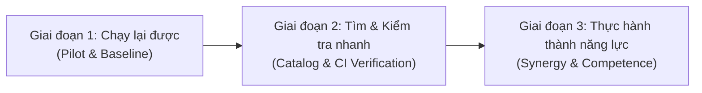
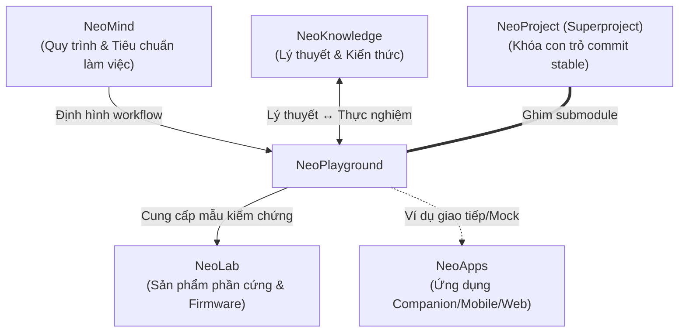

# Repo Plan — NeoPlayground

> **Trạng thái tài liệu:** Kế hoạch kiến trúc & lộ trình phát triển (Planning Phase)  
> **Áp dụng cho submodule:** `NeoPlayground/` (`git@github.com:NeoTech-vietnam/NeoPlayground.git`)  
> **Ngôn ngữ:** Tiếng Việt  
> **Ngày lập:** 24/10/2026  

---

## 1. Mục tiêu và Phạm vi (Goals & Scope)

### 1.1. Mục tiêu cốt lõi
`NeoPlayground` là không gian lưu trữ tập trung cho các hoạt động thực hành lập trình, thí nghiệm kỹ thuật độc lập và các ví dụ mã nguồn có thể chạy được (*code practice, experiments, and runnable examples*). 

Mục tiêu tối thượng của kho mã nguồn này là tính **tái lập được (reproducibility)**: bất kỳ thành viên nào trong đội ngũ khi mở một thư mục ví dụ và làm theo tài liệu hướng dẫn (`README.md` của ví dụ đó) đều có thể tái lập chính xác kết quả thực nghiệm.

### 1.2. Phạm vi nền tảng
- **Nền tảng trọng tâm đã xác nhận (theo ghi nhận kiến trúc):**
  - **ESP32:** Các bài tập và ví dụ thực hành theo framework (ESP-IDF, Arduino Core, FreeRTOS, Zephyr) và theo board phát triển thực tế.
  - **STM32:** Các bài tập và ví dụ theo dòng chip (STM32F4, STM32C0, STM32H7...), vi điều khiển trần (Bare-metal), HAL hoặc RTOS.
- **Các nền tảng đề xuất mở rộng:**
  - **Desktop / OS:** Các ví dụ lập trình hệ thống phụ thuộc hệ điều hành trên Linux và Windows (Sockets, IPC, Multi-threading, Serial communication...).
  - **Languages:** Các thử nghiệm độc lập về ngôn ngữ lập trình (C, C++, Modern C++, Python, Rust...).
  - **Algorithms:** Các bài tập thuật toán, cấu trúc dữ liệu ứng dụng trong hệ thống nhúng và xử lý dữ liệu.

### 1.3. Nguyên tắc vận hành kỹ thuật
- **Nguồn chuẩn duy nhất (Single Source of Truth):** Mỗi ví dụ mã nguồn chỉ tồn tại tại một vị trí duy nhất trong cây thư mục của `NeoPlayground`. Tuyệt đối không sao chép nguyên trạng cùng một ví dụ sang nhiều chủ đề hoặc nhiều thư mục khác nhau.
- **Không ép buộc hệ thống build chung (Decoupled Build Systems):** Không áp đặt một hệ thống build duy nhất (như toàn bộ CMake hay toàn bộ Makefile) cho toàn bộ repo. Mỗi nền tảng và từng ví dụ cụ thể được tự do sử dụng công cụ build tự nhiên và phù hợp nhất với nền tảng đó (ví dụ: `idf.py` cho ESP-IDF, `make`/`cmake` cho STM32, `cargo` cho Rust, `gcc`/`clang` cho C/C++, `pytest` cho Python).
- **Phân định rõ ràng giữa thử nghiệm và sản phẩm:** `NeoPlayground` là nơi thử nghiệm, tích lũy kinh nghiệm và kiểm chứng tính năng. Mã nguồn tại đây chưa phải là mã nguồn sản phẩm hoàn chỉnh và không chịu ràng buộc về tiêu chuẩn phát hành sản phẩm thương mại của `NeoLab`.

---

## 2. Hiện trạng thực tế và Bằng chứng xác minh (Current State & Verified Evidence)

### 2.1. Dữ kiện thực tế đã xác minh (Verified Facts)
Các dữ kiện dưới đây được kiểm tra và xác minh trực tiếp trên hệ thống tệp và Git repository cục bộ tại thời điểm lập kế hoạch:
- **Cấu trúc submodule:** `NeoPlayground` là một trong 5 submodule trực tiếp cấp gốc của superproject `NeoProject` (được khai báo tại `.gitmodules`).
- **Nội dung tệp hiện tại:** Submodule hiện chỉ chứa duy nhất một tệp [README.md](file:///H:/Learning/Neo/NeoProject_worktrees/drifting-finch/NeoPlayground/README.md) gồm 2 dòng mô tả ban đầu:
  ```markdown
  # NeoPlayground
  Independent coding exercises, experiments, and runnable examples for ESP32, STM32, desktop platforms, languages, and algorithms. Examples document their environment, execution steps, and expected results.
  ```
  Chưa có bất kỳ mã nguồn, thư mục con hay tệp cấu hình nào khác tồn tại trong repository.
- **Commit khởi tạo (Initial Commit):**
  - Commit SHA: `7aede8a913dd3dd41b83c6359b9e403ce65d0a7c`
  - Tác giả: `Hieu Tran <103094887+TNH510@users.noreply.github.com>`
  - Thời gian: `Sat Oct 24 15:10:51 2026 +0700`
  - Thông điệp: `Initial commit`
- **Git Remote và Giao thức kết nối:**
  - Remote thực tế trong Git config của submodule: `origin git@github.com:NeoTech-vietnam/NeoPlayground.git` (giao thức SSH).
  - Tương tự, tệp `.gitmodules` của superproject ghi nhận: `url = git@github.com:NeoTech-vietnam/NeoPlayground.git`.
- **Liên kết từ Superproject (Gitlink):**
  - Superproject `NeoProject` ghim chính xác commit con trỏ: `160000 commit 7aede8a913dd3dd41b83c6359b9e403ce65d0a7c NeoPlayground`.
- **Tình trạng di trú (Migration Status):**
  - Hoàn toàn **chưa thực hiện di trú** bất kỳ nội dung nào từ các kho lưu trữ cũ sang `NeoPlayground`.
- **Tình trạng các kho ví dụ tiền thân (Existing Example Repositories):**
  - Các kho ví dụ tiền thân tồn tại độc lập dưới tổ chức `NeoTech-vietnam` (trạng thái Private) gồm:
    - `NeoExamples`
    - `NeoExamples-Window`
    - `NeoExamples-ESP32-FreeRTOS`
    - `NeoExamples-ESP32`
    - `NeoExamples-ESP32-Zephyr`
    - `NeoExamples-Linux`
    - `NeoExamples-STM32`
    - `NeoExamples-Android`
  - Tất cả các kho trên hiện vẫn đang đứng riêng biệt, giữ nguyên trạng, chưa hề được sát nhập hay kế thừa vào `NeoPlayground`.

### 2.2. Nhận xét về thông tin lịch sử trong Canvas (`NeoProject.canvas`)
Khi đối chiếu với tài liệu kiến trúc [NeoProject.canvas](file:///H:/Learning/Neo/NeoProject_worktrees/drifting-finch/docs/NeoProject.canvas) (ảnh chụp ngày 24/10/2026):
- Thẻ `setup-pins` và các node ghi nhận URL dưới dạng web/HTTPS (`https://github.com/NeoTech-vietnam/NeoPlayground`). Trong thực tế cấu hình Git hiện hành, toàn bộ đã được chuẩn hóa sang giao thức SSH (`git@github.com:NeoTech-vietnam/NeoPlayground.git`).
- Vị trí tệp Canvas nằm tại `docs/NeoProject.canvas` trong superproject `NeoProject`, phản ánh kiến trúc cấp cao gồm 5 submodule trực tiếp.
- Các cam kết con trỏ ban đầu ghi trên Canvas là các commit chỉ có `README.md`, không phải là các bản phát hành sản phẩm đã qua kiểm định (*not validated product baselines*).

---

## 3. Cấu trúc thư mục tương lai đề xuất (Proposed Future Directory Structure)

> [!IMPORTANT]
> Cấu trúc dưới đây là **đề xuất kiến trúc** nhằm chuẩn hóa việc tổ chức thư mục khi bắt đầu tiếp nhận mã nguồn. Trong giai đoạn lập kế hoạch hiện tại (Phase `planning`), **không tự ý tạo cây thư mục rỗng hay di chuyển mã nguồn**.

```text
NeoPlayground/
├── .gitignore                      # Loại trừ các file build artifact, binary, temporary files
├── README.md                       # Giới thiệu tổng quan về repository và mục lục định hướng
├── docs/                           # Tài liệu kỹ thuật chung của repository
│   ├── Repo Plan.md                # Kế hoạch phát triển repository (tài liệu này)
│   ├── EXAMPLE_TEMPLATE.md         # Bản mẫu (template) quy chuẩn cho README của mỗi ví dụ
│   └── CONTRIBUTING.md             # Hướng dẫn đóng góp bài thực hành mới
│
├── esp32/                          # Không gian thực hành cho nền tảng ESP32
│   ├── esp-idf/                    # Các bài thực hành sử dụng ESP-IDF framework
│   │   ├── gpio_blink/             # Ví dụ: Điều khiển GPIO cơ bản
│   │   └── ble_beacon/             # Ví dụ: Quảng bá Bluetooth Low Energy
│   ├── arduino/                    # Các bài thực hành trên nền Arduino Core cho ESP32
│   ├── freertos/                   # Các bài thực hành về FreeRTOS chuyên sâu trên ESP32
│   └── zephyr/                     # Các bài thử nghiệm Zephyr RTOS trên ESP32
│
├── stm32/                          # Không gian thực hành cho nền tảng STM32
│   ├── baremetal/                  # Các bài thực hành trực tiếp với thanh ghi (Registers)
│   ├── hal/                        # Các bài thực hành dựa trên STM32Cube HAL / LL
│   │   ├── stm32f4/                # Phân nhóm theo họ vi điều khiển khi cần thiết
│   │   └── stm32c0/
│   └── rtos/                       # Các bài thực hành FreeRTOS / CMSIS-RTOS trên STM32
│
├── os/                             # Không gian thực hành ví dụ phụ thuộc hệ điều hành
│   ├── linux/                      # Linux system programming (socket, thread, epoll, i2c-dev)
│   └── windows/                    # Windows system / driver / serial programming
│
├── languages/                      # Thử nghiệm tính năng và cú pháp ngôn ngữ lập trình
│   ├── c/                          # Kỹ thuật C nâng cao (pointer, memory management, data packing)
│   ├── cpp/                        # Modern C++ (C++17/20, templates, OOP, embedded C++)
│   └── python/                     # Python scripts thử nghiệm xử lý dữ liệu, automation
│
└── algorithms/                     # Bài tập thuật toán và cấu trúc dữ liệu
    ├── data_structures/            # Ring buffer, linked list, memory pool, state machine
    └── math_dsp/                   # Thuật toán lọc (FIR, IIR, Kalman cơ bản), biến đổi tín hiệu
```

### 3.1. Phân định trách nhiệm và nguyên tắc nguồn chuẩn (Single Source of Truth)
- **Tính độc lập:** Mỗi thư mục con của một ví dụ (ví dụ `esp32/esp-idf/gpio_blink/`) là một dự án độc lập, có thể mở riêng biệt trong IDE (như VS Code, CLion, STM32CubeIDE) mà không làm ảnh hưởng đến các thư mục khác.
- **Không sao chép chéo:** Nếu một ví dụ kết hợp cả thuật toán (thuộc `algorithms/`) trên nền STM32, vị trí chuẩn sẽ được đặt tại `stm32/` và chỉ dẫn chiếu tài liệu giải thuật về `algorithms/` hoặc `NeoKnowledge`, không copy thành 2 bản mã nguồn.

### 3.2. Tiêu chuẩn bắt buộc cho mỗi ví dụ thực hành (Standard Example Specification)
Mỗi thư mục ví dụ bắt buộc phải đi kèm một tệp `README.md` theo cấu trúc chuẩn:
1. **Mục tiêu (Objective):** Trình bày ngắn gọn ví dụ giải quyết vấn đề gì, minh họa cho khái niệm nào.
2. **Yêu cầu môi trường & Phần cứng (Hardware & Environment Requirements):**
   - Phiên bản SDK / Toolchain chính xác (ví dụ: `ESP-IDF v5.1.2`, `Arm GNU Toolchain 13.2.rel1`).
   - Board phát triển / Vi điều khiển chính xác (ví dụ: `ESP32-WROOM-32D`, `NUCLEO-F401RE`).
   - Sơ đồ đấu nối dây / Chân GPIO (Pinout & Schematics).
3. **Các lệnh biên dịch & nạp (Build, Flash & Run Commands):**
   - Các lệnh cụ thể để build trên terminal mà không phụ thuộc vào thiết lập IDE cá nhân.
4. **Kết quả mong đợi (Expected Output):**
   - Mô tả tín hiệu đèn LED, log serial tại baud rate cụ thể, hoặc ảnh chụp màn hình oscilloscope/logic analyzer.
5. **Minh bạch trạng thái kiểm thử (Verification Status):** Mỗi ví dụ phải ghi rõ 1 trong 3 mức trạng thái:
   - `[ ] Chưa chạy (Untested / Planned)`: Mã nguồn mới đưa vào hoặc phác thảo, chưa được kiểm tra biên dịch.
   - `[x] Build được (Build Verified)`: Đã biên dịch thành công trên máy tính với toolchain chỉ định; chưa kiểm chứng trên phần cứng thật.
   - `[x] Đã chạy trên board (Hardware Verified)`: Đã nạp trực tiếp vào board mạch thật, hoạt động đúng như tài liệu mô tả (kèm thông tin model board và revision đã test).
6. **Bỏ theo dõi artifact tự động:** Mọi file sinh tự động (`build/`, `.o`, `.elf`, `.bin`, `.hex`, `.map`, IDE metadata) phải được đưa vào `.gitignore` ngay từ đầu.

---

## 4. Lộ trình triển khai (Roadmap & Milestones)

Quá trình xây dựng `NeoPlayground` được chia làm 3 giai đoạn rõ ràng, bảo đảm tính thực chất và không tạo gánh nặng quản lý.



### 4.1. Giai đoạn đầu · Chạy lại được (Reproducible Baseline)
- **Trọng tâm công việc:**
  1. Kiểm kê danh mục các ví dụ đang nằm rải rác tại các repo `NeoExamples*` cũ để đánh giá chất lượng và khả năng tái sử dụng.
  2. Chọn lọc và chuyển giao thử nghiệm (pilot) một số lượng nhỏ ví dụ tiêu biểu (ví dụ: 1 bài ESP32 kinh điển và 1 bài STM32 chuẩn mực).
  3. Bổ sung `README.md` chuẩn hóa cho từng bài pilot: ghi rõ mục tiêu, môi trường, lệnh chạy, kết quả mong đợi.
  4. Giữ vững liên kết với các bài học lý thuyết tương ứng trong `NeoKnowledge`.
  5. Cấu hình `.gitignore` chuẩn hóa, loại bỏ hoàn toàn mã nhị phân sinh tự động.
- **Đầu ra (Deliverables):**
  - Mẫu tài liệu `docs/EXAMPLE_TEMPLATE.md`.
  - Bộ 2 ví dụ pilot đầu tiên (ESP32 và STM32) có thể chạy lại được hoàn chỉnh.
- **Tiêu chí hoàn thành (Exit Criteria):**
  - Một thành viên khác trong nhóm đọc `README.md` của bài pilot, thực hiện đúng các bước và nạp chạy thành công trên phần cứng thật mà không cần hỏi thêm người viết.

### 4.2. Giai đoạn mở rộng · Tìm và kiểm tra nhanh (Catalog & Verification)
- **Trọng tâm công việc:**
  1. Xây dựng bảng mục lục tổng quan (Catalog/Index) tại root `README.md`, phân nhóm theo nền tảng, công nghệ và mức độ khó.
  2. Ghi chú minh bạch trạng thái 3 mức (`Chưa chạy` / `Build được` / `Đã chạy trên board`) kèm phiên bản SDK và phần cứng cụ thể.
  3. Triển khai các workflow kiểm tra tự động (CI compile checks): Thiết lập GitHub Actions tự động kiểm tra biên dịch (build check) cho các bài code chạy trên PC (Linux/Windows) hoặc các bài firmware có thể compile headless bằng compiler containerized.
  4. Tuyệt đối không ép buộc một hệ thống build chung; CI sẽ gọi đúng hệ build của từng thư mục.
- **Đầu ra (Deliverables):**
  - Bảng tra cứu mục lục trực quan liên kết trực tiếp tới các bài ví dụ.
  - File cấu hình CI cho compile testing.
- **Tiêu chí hoàn thành (Exit Criteria):**
  - 100% các ví dụ được đưa vào kho đều có thông tin trạng thái kiểm thử rõ ràng; các ví dụ tuyên bố "Build được" phải vượt qua kiểm tra tự động của CI.

### 4.3. Giai đoạn dài hạn · Thực hành thành năng lực (Competence & Synergy)
- **Trọng tâm công việc:**
  1. Xây dựng các chuỗi bài thực hành liên hoàn từ cơ bản (Hello World, GPIO, Interrupt) đến nâng cao (RTOS, Power Management, Communication Bus, OTA, Bảo mật).
  2. Bổ sung các bài tập đo đạc tín hiệu, chẩn đoán lỗi phần cứng/phần mềm (troubleshooting/debugging lab) kèm tài liệu phân tích nguyên nhân gốc rễ và đáp án tham khảo.
  3. Phản hồi các phát hiện và kết quả đo đạc thực nghiệm ngược lại cho `NeoKnowledge` để củng cố lý thuyết.
  4. Tuyển chọn các module, driver hoặc giải pháp thử nghiệm đã qua kiểm chứng ổn định tại `NeoPlayground` làm điểm xuất phát cho các dự án sản phẩm của `NeoLab`.
  5. Chỉ xem xét tách thư viện dùng chung (Common Shared Library) khi thực sự có nhiều bài cùng cần và giao diện API đã ổn định.
- **Đầu ra (Deliverables):**
  - Hệ thống giáo trình thực hành theo chuyên đề hoàn chỉnh.
  - Tập hợp các module nền tảng được chứng thực để chuyển giao sang `NeoLab`.
- **Tiêu chí hoàn thành (Exit Criteria):**
  - Khép kín chu trình học tập và phát triển: Lý thuyết từ `NeoKnowledge` được chứng minh tại `NeoPlayground` và được hiện thực hóa thành sản phẩm trong `NeoLab`.

---

## 5. Phụ thuộc và Ràng buộc với các Repo khác (Dependencies & Boundaries)

Mối quan hệ giữa `NeoPlayground` và các repo khác trong hệ sinh thái `NeoProject` là **quan hệ tham chiếu chức năng**, không phải quan hệ lồng ghép tệp hay phụ thuộc vòng:



### 5.1. Với `NeoKnowledge`
- **Ranh giới:** Snippet giải thích ngắn, sơ đồ nguyên lý và lý thuyết nền tảng nằm tại các note của `NeoKnowledge`. Toàn bộ mã nguồn hoàn chỉnh, cấu hình build và dự án có thể chạy được thuộc quyền sở hữu của `NeoPlayground`.
- **Liên kết:** Note trong `NeoKnowledge` dẫn link sang thư mục ví dụ của `NeoPlayground` để người học thực hành; `README.md` của ví dụ dẫn ngược về note tương ứng để người học nắm lý thuyết.

### 5.2. Với `NeoLab`
- **Ranh giới:** `NeoPlayground` chỉ chứa các thử nghiệm độc lập, mang tính nghiên cứu và ví dụ minh họa. Toàn bộ mã nguồn sản phẩm chính thức, sơ đồ mạch chi tiết (schematic/PCB layout), hồ sơ revision phần cứng và mã thương mại phải nằm tại `NeoLab`.
- **Chuyển giao:** Khi một thử nghiệm tại `NeoPlayground` đạt độ tin cậy cao, nó có thể được chọn làm điểm xuất phát để phát triển mã nguồn sản phẩm tại `NeoLab`.

### 5.3. Với `NeoApps`
- **Ranh giới:** `NeoPlayground` có thể chứa các script nhỏ giả lập thiết bị (mock device / stub BLE) hoặc ví dụ giao tiếp đơn giản nhằm kiểm tra kết nối với app. Toàn bộ ứng dụng thực tế (Web, Android, iOS) thuộc thẩm quyền của `NeoApps`.

### 5.4. Với `NeoMind`
- Tiếp nhận các chuẩn mực về Git workflow, quy chuẩn đặt tên, tài liệu hóa và phối hợp giữa các đặc vụ từ `NeoMind`.

### 5.5. Với `NeoProject` (Superproject)
- **Cơ chế con trỏ tĩnh (Submodule commit locking):**
  - `NeoPlayground` làm việc độc lập hằng ngày trên các branch riêng (`main`, feature branch). Các commit phát triển hằng ngày tại đây không làm thay đổi con trỏ của `NeoProject`.
  - `NeoProject` chỉ ghim (pin) commit cụ thể khi commit đó được đánh giá là **ổn định (stable)** trong phạm vi của Playground hoặc phục vụ một mốc kiểm tra tích hợp cụ thể.
  - **Không bắt buộc tag/release:** `NeoPlayground` có tính chất cập nhật liên tục, không bắt buộc phải phát hành version hoặc tag định kỳ theo lịch trình chung. Khi cần khóa mốc, `NeoProject` chỉ việc commit con trỏ commit SHA cụ thể.

---

## 6. Quyết định còn mở và Bước tiếp theo (Open Decisions & Next Steps)

### 6.1. Các quyết định còn mở (Open Decisions)
1. **Phương án kế thừa từ `NeoExamples` cũ:**
   - Cần chốt phương án di trú: Chuyển giao toàn bộ có chọn lọc bằng cách copy mã nguồn sạch (clean copy) và tái cấu trúc lại theo tiêu chuẩn mới, hay giữ lại Git history của từng repo `NeoExamples-*` cũ?
   - Đề xuất: Nên áp dụng phương án chuyển giao từng nhóm nhỏ có chọn lọc (selective clean migration), chỉ lấy các bài thực sự chạy được và bổ sung ngay `README.md` chuẩn hóa; tránh mang các file nhị phân rác từ repo cũ sang.
2. **Xử lý các đoạn mã bài tập nhỏ cạnh Note:**
   - Trong quá trình học tại `NeoKnowledge`, có nhiều bài tập nhỏ hoặc snippet 10-20 dòng. Có cho phép ngoại lệ lưu trực tiếp các snippet này trong note không, hay mọi đoạn mã đều phải có thư mục riêng trong `NeoPlayground`?
   - Đề xuất: Cho phép các snippet giải thích ngắn (< 30 dòng) nằm trong note của `NeoKnowledge`; mọi bài tập có cấu trúc build hoặc cần nạp board đều phải đưa vào `NeoPlayground`.
3. **Quản lý tài nguyên lớn và Firmware Artifacts:**
   - Các file binary lớn (ví dụ model AI cho ESP32-S3, file âm thanh mẫu, firmware test pre-built) sẽ lưu tại đâu? (Khuyến cáo không commit trực tiếp vào Git history của Playground để tránh phình repo; cần chốt dùng GitHub Releases, Git LFS hay liên kết lưu trữ đám mây).
4. **Hạ tầng CI cho Embedded:**
   - Xác định phạm vi CI: Chỉ dừng lại ở việc kiểm tra cú pháp và build các bài C/C++/Python trên máy ảo Ubuntu, hay đầu tư thiết lập runner có toolchain ESP-IDF và ARM GCC để compile check toàn bộ firmware?

### 6.2. Các bước hành động tiếp theo (Next Steps)
1. **Lưu trữ và duy trì tài liệu kế hoạch:**
   - Hoàn thành tài liệu [Repo Plan.md](file:///H:/Learning/Neo/NeoProject_worktrees/drifting-finch/NeoPlayground/docs/Repo Plan.md) trên branch `docs/repo-plan` của repo con `NeoPlayground`.
   - Không thực hiện commit, push hay merge ở giai đoạn này theo đúng hướng dẫn điều phối.
2. **Chuẩn bị bản mẫu tài liệu ví dụ:**
   - Khi bước vào giai đoạn thực thi (Implementation Phase), tạo tệp `docs/EXAMPLE_TEMPLATE.md` làm tiêu chuẩn cho mọi đóng góp mới.
3. **Thực hiện bài Pilot đầu tiên:**
   - Chọn lọc 1 ví dụ ESP32 tiêu chuẩn từ `NeoExamples-ESP32` để đưa vào `esp32/esp-idf/` làm chuẩn mực tham chiếu.
